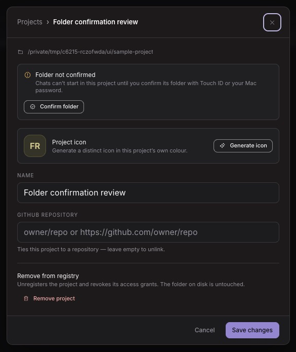
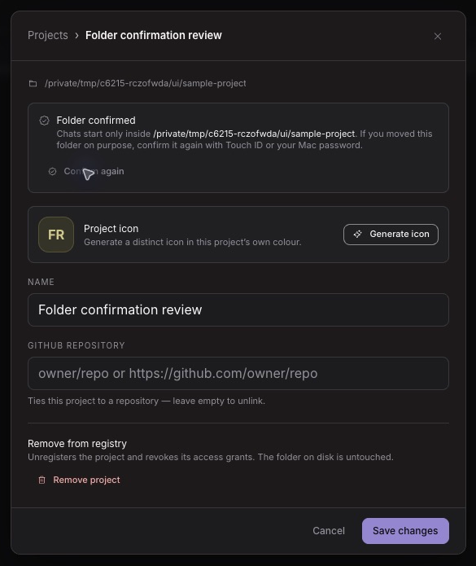

# Issue #6215 delivery receipts

Continuation of session `7fcd2b86`’s unfinished snapshot `641530e7d248f9e51088d9e7ecd5f9befcc385bd` on `backup/issue-6215-pin-project-root-snapshot-20261029`, originally based on `f0411258e1545f101ffda264d0b0c49392709d27`. This continuation reuses Val’s delivered `.worktrees/issue-6393-grant-sandbox` on `fix/issue-6215-pin-project-root-v2`, from refreshed main `fea63da7a524d7a78e22b63e414ef9e6023ffe3c`. The prior local `fix/issue-6393-mcp-boundary` branch remains at `7e2037d517395c13dc3feef001d484ee931f7298`; no worktree was created or removed.

The original October 27 decision remains: pin at registration, a root edit, or explicit human folder confirmation; refuse moved roots with 409 and refuse legacy roots until confirmed. Val’s clarification in this continuation chooses native authentication, preferably Touch ID. Both confirmation and root edits require fresh macOS Touch ID authentication, with identity rechecked under the registry lock afterward. Password and Apple Watch fallback are excluded: Val’s native retry of the original broad device-owner policy returned success without any prompt appearing, so that policy failed human acceptance and was replaced. Macs without available enrolled Touch ID also fail closed. Linux and Windows currently fail closed for that ceremony; their native confirmation support is not implemented.

## Failing-first evidence

| Receipt retained locally | Observed failure |
| --- | --- |
| `red-security-main.log` | Current main accepted a retargeted registered root and an unconfirmed legacy project: both expected rejections were missing. |
| `red-project-routes-main.log` | Registration/root edits did not write a pin; confirmation was not implemented. |
| `red-pinned-resume-identity.log` | After retargeting the registered alias, the persisted canonical cwd lost its registered identity. |
| `red-main-route-redirect-control.log` | With the four owning main source modules loaded from `fea63da7a` through an isolated loader, the real send route returned 200 for the newly added redirect regression, where 409 was required. Working files were not replaced. |
| `red-confirm-familiar-fields.log` | The imported snapshot returned 400 for familiar-relayed confirmation rather than the explicit 403 refusal. |
| `red-pinned-worktree-containment.log` | Final review caught a pinned worktree link escaping into an in-project sibling; the moved-root-only lookup is now restricted so the old containment check still applies. |
| `red-registration-await-redirect.log` | A redirect while registration awaited registry I/O was silently adopted as its pin; identity is now captured before that I/O. |
| `red-pinned-twin-identity.log` | Saved pins initially chose the first alias registration; the unique-ID check now preserves #6210’s ambiguous-twin refusal. |
| `red-canonical-grant-level-merge.log` | A later read alias erased an existing write grant when both were bound to one canonical root; the most-permissive merge from #6216 is preserved. |
| `red-native-human-confirmation.log`, `red-final-spawn-helper.log` | The new authoritative confirmation/launch helpers were absent before implementation. These are missing-module evidence, separate from behavioral red evidence above. |

## Acceptance evidence

| Requirement | Evidence and disposition |
| --- | --- |
| Retargeted registered root | Pass in `project-root-pin-regression.test.ts`, shared launch tests, and the real Codex send-route fixture; includes redirect into a child of the pin. |
| Legitimate alias registration | Pass in registration/shared launch/identity tests and real send-route fixture under alias HOME; full-suite receipts recorded below when complete. |
| Legacy refuses, then works after one confirmation | Pass in the project-route integration fixture composed with the real registry and grant checks; no pin is written by a refused launch. |
| Missing and revoked grants | Pass before the pin check, using both the shared gate and the real permission store in the confirmation integration fixture. |
| Resumed/hidden-generation turn | Pass in the real send-route fixture: fresh, resumed and canvas-origin sends refuse a moved root without probing or launching a harness. |
| Board and worktrees | Pass in the shared gate/identity tests; saved directory identity drives containment. |
| Familiar/mobile confirmation | Pass in HTTP integration tests: relay fields and mobile ingress get 403, and direct localhost confirmation/root edits cannot succeed when OS authentication fails. The OS primitive is stubbed in this HTTP fixture; authentication binding/denial is independently tested. |
| Same grant/spawn/write-scope directory | Confirmed canonical roots are forwarded to grant arguments and Claude scope; root identity is checked after runtime resolution and again before dispatch/spawn/retries. Focused helper and real-route tests cover the boundaries. |
| No migration or root-key rewrite | Pass in store/route tests: legacy rows remain unpinned on read/launch; confirmation preserves `project.root`. Avatar, pin and override stores are untouched. |
| Native helper build and packaging | Pass locally: compiled Mach-O ARM64 helper; final production build traces the executable without `outputFileTracingIncludes`, and the standalone copy has the same SHA-256. No release or installed-package qualification is claimed. |
| Human visual/native acceptance | **Pass on this Mac** for the replacement Touch ID-only ceremony, explicitly approved by Val; visual and installed-package sign-off remain **needs-Val**. The original broad-policy ceremony **failed**: Val reported no prompt appeared on the requested retry despite a refreshed confirmation timestamp. Captures below were observed in the default Dia browser against the production artifact and a disposable project/roster. The original OS request completed and the UI/persisted pin changed to confirmed without observed human approval; those images are historical UI evidence, not successful native acceptance. Dark was inspected; light, another theme, and packaged-app acceptance remain needs-Val. The later Touch ID-only retry was explicitly approved by Val, as recorded below. |
| Windows/Linux native confirmation | **fail / review limitation**: unavailable, with no localhost or UI-only fallback. Existing pinned projects remain launchable when their directory/grant checks pass. |
| Merge, release, closure | Held for Val’s exact-head merge approval. No release or issue closure is authorized. |

## Visual review steps

1. Run the production build from this owned unit and open the observed loopback origin in the default browser, using a disposable Cave home and a synthetic roster rather than a live provider.
2. Open Chat → Projects → the project’s settings button. A legacy row shows **Folder not confirmed** and **Confirm folder**, with Touch ID guidance.
3. Choose **Confirm folder**, inspect the project and resolved directory in the native prompt, then approve or cancel on the Mac. Cancellation must preserve the old pin; a folder change during the prompt must require another review.
4. After approval, verify **Folder confirmed**, the saved canonical directory, **Confirm again**, and the screen-reader announcement. Check dark/light, another theme, narrow layout, keyboard focus/trapping/return, and the error state before signing off.

The two images crop only the app dialog out of the actual browser screenshots. Full window captures remain local and are excluded from publication. These captures predate the Touch ID-only repair and contain the original password fallback copy. The confirmed image records the earlier request result, which failed native human acceptance; neither image is Val’s visual sign-off.

## Verification history

Raw stdout/stderr stays in this directory locally. Initial API/app runs exposed snapshot privacy pins, a missing restricted-environment `NODE_ENV`, the native spawn’s missing `windowsHide`, alias-forwarding expectations, the new PATCH method inventory, and the imported UI copy pin. Each first failure is retained. Two concurrent API attempts collided because the contract-export test temporarily rewrites shared fixture bytes; only that test-owned fixture was restored from HEAD and its read-only check passed, then API runs were serialized. A tracing-include attempt failed the repository’s existing standalone contract; it was removed, and the final helper is traced through its bounded runtime path instead. One manual focused invocation omitted the repository’s alias loader and failed before test execution; the wired-loader rerun passed. No tests or security gates were disabled. The isolated-HOME app run reports its two existing Chromium-canvas checks as skipped because the browser is not installed in that synthetic profile; the focused Project access browser run used the installed browser cache and passed eight checks without retries.

The original-head local gate totals are below; renewed repair gates are recorded in the native repair section. Hosted exact-head results are recorded on #6215 and the PR; human acceptance remains separate.

| Gate | Result | Local raw receipt |
| --- | --- | --- |
| `pnpm test:api`, `HOME=/tmp/c6215-rczofwda/alias` | 617 files passed | `api-alias-source-final.log` |
| `pnpm test:api`, `HOME=/private/tmp/c6215-rczofwda/physical` | 617 files passed, run serially after alias HOME | `api-physical-source-final.log` |
| `pnpm test:app` | 1,505 files passed; existing isolated-profile browser skip recorded above | `app-source-final.log` |
| `pnpm test:mobile` | 106 files passed; source/contract evidence, not physical iOS acceptance | `mobile-final.log` |
| `pnpm typecheck` | Passed | `typecheck-delivery.log` |
| `pnpm lint` and focused lint after the final repairs | Passed | `lint-full.log`, focused command receipts |
| `pnpm check:tests-wired` | 2,237 files wired | command output / test runner manifest |
| Production Project access browser run | 8 passed, no retries | `projects-ui-playwright.log` |
| `pnpm build` | Passed, including bundle/standalone budgets: 7,786 files, 194,881,348 bytes | `build-delivery.log` |
| Native deployment compatibility | ARM minimum 11.0; cross-compiled Intel minimum 10.13; current-Mac availability check passed | `native-helper-platform-after.log`, `native-helper-x64-platform.log` |

The native compiler’s initial host-default target was macOS 27.2. It was corrected to the existing Tauri platform floors before delivery, then the production artifact was rebuilt and its traced helper hash matched the build input. The original helper SHA-256 was `0330214996928c479bea3eccb4e0fbde0856129ee2447bb85016c3cda51a3bf4`; the replacement helper identity is recorded with renewed validation below. The owned screenshot server and synthetic roster were stopped and their port/socket cleanup was verified. Raw receipts remain intentionally local and ignored; the reviewed screenshots and this summary are committed.

## Native acceptance repair

Val reported that no prompt appeared on the broad-policy retry, although the disposable project timestamp changed to `2026-11-10T04:12:30.492Z`. This is a failed human-authentication acceptance result at `00b651310`, retained in issue comment 6758834093. The helper now uses `deviceOwnerAuthenticationWithBiometrics`, zero Touch ID reuse, and an empty fallback title, so neither password nor Apple Watch can satisfy this operation. `red-touch-id-only-policy.log` captures the failing native-policy regression before the repair; `green-touch-id-only-policy.log` records the corrected contract. The replacement native request remained pending until approval. Val explicitly reported “Prompt appeared; I approved”, and the disposable project’s saved confirmation timestamp changed to `2026-11-10T04:19:22.264Z`. This verifies an observed Touch ID ceremony on this Mac, separately from remaining visual and installed-package acceptance. Renewed app (1,505 files), alias-HOME API (617 files), typecheck, lint and production build passed. The serialized physical-HOME API run also passed all 617 files. All required renewed local gates passed before the repair push. The rebuilt standalone helper matches SHA-256 `64690bee54f2d7dd31337f99aef465bdf8a22d15257854b3679a96d330e3c7af`; ARM and Intel compilation/deployment-floor checks passed again. Raw repair receipts are `app-touchid.log`, `api-touchid-alias.log`, `api-touchid-physical.log`, `typecheck-touchid.log`, `lint-touchid.log`, `build-touchid.log`, and `native-touchid-*.log`/`native-touchid-helper-hashes.txt`.

The replacement review server also reached the existing HTTP shutdown deadline (exit 1) after all workers drained; its native request had already completed successfully. `ui-touchid-server.log` retains that diagnostic. Both retry servers and synthetic rosters are stopped, with owned ports and sockets verified clear. This shutdown limitation is separate from native authentication acceptance.
