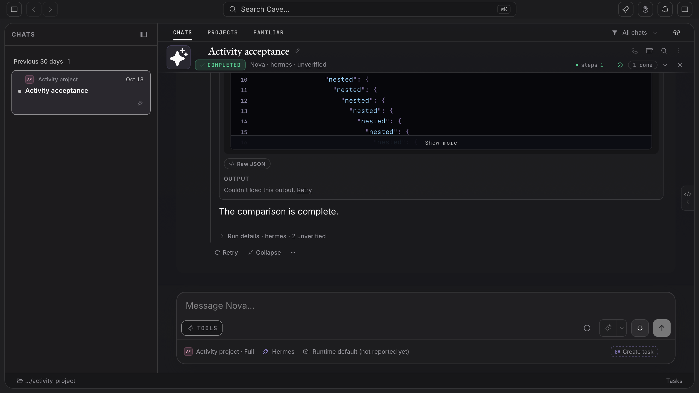

# Golden-14 diagnostic checkpoint, 12 November 2026

Status: incomplete. This packet reproduces #6064's dropped WebKit Retry on current main and retains request/event evidence. It contains no product repair, no green regression claim and no full golden-14 acceptance. The activated eight-hour wall-clock window elapsed during permission waits; execution stopped for handoff after collecting the in-flight run.

## Candidate and boundary

The unchanged production application is built from `db435727c55fbdc3c4d432f6121f0754b3989fdc`, Next build ID `Sysqv8cmAEReOV6UeqtX7`. Environment: macOS 27.2.1 arm64, Node 24.22.0, pnpm 10.34.0, Next 16.4.3, Playwright 1.62.0, Chromium revision 1234 and WebKit revision 2336. The browser fixtures use synthetic routed API responses, isolated state, desktop browser presets, one worker, zero retries, no tracing and no video. They prove production-client behavior, not real-server authorization, an installed package, a physical device or human accessibility acceptance. The source candidate is local development evidence; it does not replace #5767's separately admitted qualification tuple.

## Reproduction and observed boundary

The unchanged `lazy output` cases ran five times each on WebKit: 24 passed, one oversized-output case failed when the authorized marker did not appear after Retry. All earlier failures are retained in the local receipt directory. A separate production pass of the large-trace and refusal cases across Chromium and WebKit passed all 12 cases, with no skips or retries. That passing invocation does not resolve the intermittent failure.

A subsequent WebKit run of the 404, 409 and oversized cases, ten times each, added passive event capture and a diagnostic attachment around the unchanged Retry click/assertion: 28 passed and two failed (409 and 404). Each failed attempt contains only the original refusal request. In both failures, `pointerdown` targets the Retry `BUTTON`, `pointerup` targets a `SPAN`, and `click` targets the containing `DETAILS`, not Retry. The fetch hook therefore receives no second request. The retained events narrow the defect to pointer-target continuity before the click handler; they do not yet establish which layout or DOM change caused that discontinuity.

[Request/event records](diagnostic-retry-events.json) include every diagnostic attempt. The listeners capture only event type, element tag and whether the target is Retry; they do not prevent default behavior or force layout. Collection runs after the click/assertion, and page-evaluation failure is represented explicitly rather than replacing the original assertion failure. Instrumentation may still affect scheduling; retain the independent uninstrumented failure.

The next investigation should correlate input highlighting, disclosure events and transcript scroll/layout with the interval between pointerdown and pointerup. Asynchronous highlighting is a hypothesis: SyntaxBlock replaces its plain fallback with highlighted, height-bounded content, but this packet has not isolated that transition as the cause. Do not change the hook or add delays merely because the request was missing.

## Raw baseline measurements

Each browser's 500-tool fixture records five raw reload/open/scroll samples, DOM counts, frame intervals, long-task observations and actual scroll travel. These are end-to-end fixture measurements, not p95, CPU time or a baseline/candidate performance comparison. No performance improvement is claimed. The first `frameIntervalsMs` entry subtracts a `performance.now()` reading from an rAF timestamp rather than two successive rAF timestamps; Chromium samples include negative first values. Preserve those raw entries but exclude each first entry from frame-interval or responsiveness statistics.

- [Chromium raw samples](baseline-large-trace-chromium-6064.json)
- [WebKit raw samples](baseline-large-trace-webkit-6064.json)

## Commands and outcomes

The test launcher supplied scratch HOME/COVEN_HOME/COVEN_CAVE_HOME and an explicit unused port of 3164. A local config extended the canonical Playwright config, selected Desktop Chrome/Desktop Safari, kept its API fixture environment, used the already-built production server with an explicit repository cwd, and set one worker, zero retries and trace/video off. Each invocation has a separate retained report. Local receipts are at `/private/tmp/nova6064-20261112` on the qualification host.

| Operation | Outcome |
| --- | --- |
| `corepack pnpm install --frozen-lockfile` | Passed; independent dependencies, no node_modules symlink |
| `pnpm build` under isolated state | Passed, including typecheck, bundle and standalone budgets |
| `node --experimental-strip-types --test src/lib/use-tool-output.test.ts src/lib/tool-output-fetch.test.ts` | 16 passed, zero skips |
| WebKit `--grep 'lazy output' --repeat-each 5` | 24 passed, one failed, zero retries/skips |
| Both engines `--grep 'large trace production measurements\|lazy output'` | 12 passed, zero retries/skips |
| WebKit `--grep 'lazy output (404\|409\|oversized)' --repeat-each 10` with diagnostics | 28 passed, two failed, zero retries/skips |
| `pnpm typecheck` | Passed after the final diagnostic collection guard |
| `pnpm lint` | Passed |
| `pnpm check:tests-wired` | Passed, all 2,240 files registered |
| `git diff --check` | Passed |
| `pnpm mobile:ios:xcodegen` | Generated resources and project; no native build or XCTest acceptance |

Initial environment failures are retained: sandboxed Chromium failed Mach-port registration; sandboxed WebKit aborted; both headless smoke probes succeeded after escalation. The first local config failed before executing tests because its relative server command used the config directory as cwd; setting the cwd corrected that setup defect. Initial sandboxed simulator inventory failed; escalated inventory succeeded without changing any simulator. The first failed browser screenshot was overwritten by the following invocation's output cleanup; its JSON failure/log survive. Diagnostic-run screenshots below survive in separate output and are retained here.

## Remaining original criteria

| Criterion | State and next action |
| --- | --- |
| Explain and repair Retry | Incomplete: isolate pointer-target discontinuity and add a failing deterministic regression before product changes |
| Denial, withholding, rechecks, draft retention, deep input | Bounded routed production-client evidence; intermittent Retry remains failed |
| Long-trace responsiveness | Raw 500-tool baseline measured on two engines; matched baseline/candidate comparison and full mixed/oversized matrix remain incomplete |
| Actual server authorization/persistence | Not established by routed fixtures; exercise the required isolated real-server paths |
| Packaged Tauri | Not run; browser WebKit does not qualify the package |
| Native iOS | Resource/project generation only; owned native/simulator qualification remains incomplete |
| Physical device and human accessibility | Not performed; preserve their separate gates |
| Full app/API/mobile suites and exact-head hosted checks | Not established by this checkpoint; must run for a repair candidate |

The issue and full outcome remain open. The isolated `fix/issue-6064-webkit-retry-nova` worktree is intentionally preserved for Nova/Val with the production baseline, local launcher/config and raw receipts. No foreign worktree, installed application, live user daemon, credentials, grants or simulator session was changed. No merge, release, deployment, protection change or issue closure was performed.

## Failure captures

